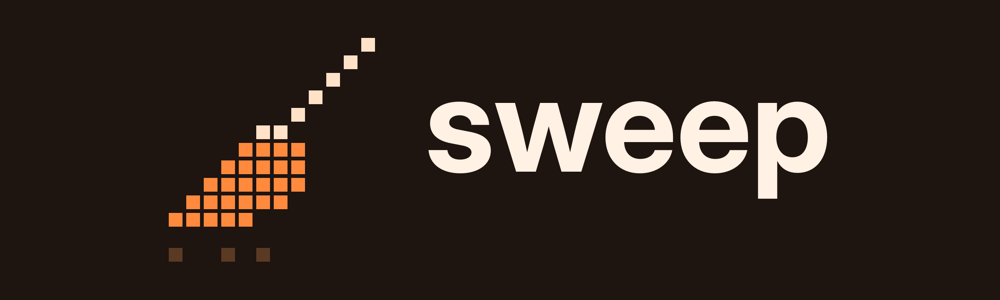

<div align="center">



# Clean up after your agents

**Finds the dev servers, browsers, worktrees and old chat logs that Claude Code and Codex left behind on your Mac, and removes only what it can prove nobody needs.**

<a href="https://github.com/karankumar24/sweep/actions/workflows/ci.yml"></a>
<a href="#install"></a>
<a href="LICENSE"></a>

</div>

---

Agents start things and forget them. A dev server from Tuesday still holds port 5173, test browsers idle in the background, worktrees pile up for branches that merged days ago, and old chat logs fill gigabytes. sweep finds them, stops what nobody is using, and asks about the rest.

```text
You:     /sweep

Claude:  Stopped
         • vite on port 5173 in ~/code/shop. Its session ended 3 days ago and
           nothing is connected to it.

         Kept
         • A headless Chrome in ~/code/shop. Its session is still running.

         Need your call
         • next on port 3000. Its session ended, but only 6 hours ago.
         • The fix-cart worktree: clean, pushed and merged.
         • 1.8 GB of chat logs older than a week.
```

Then it asks you about each one.

## How it stays safe

- **It stops a process only with proof.** The session that started it has ended, nothing is connected to it, nobody is working in its folder, and it's over a day old. If it can't check one of those, it asks.
- **Anything a running Claude session started is left alone.**
- **Worktrees and files go only when you say yes.** Files go to the Trash, never straight to deletion.
- **You can mark things to keep.** Drop an empty `.sweep-keep` file in any folder.

[The guide](docs/guide.md) covers the rest: keep lists, the optional startup reminder, and running the script on its own.

## Install

Needs macOS and Python 3.9 or newer. Cleaning up files needs macOS 15 or newer; on older versions sweep still stops orphaned processes and removes merged worktrees. Paste this in your terminal:

```bash
DIR=$(mktemp -d)
git clone --depth 1 https://github.com/karankumar24/sweep.git "$DIR"
mkdir -p ~/.claude/skills
cp -r "$DIR/skills/sweep" ~/.claude/skills/
rm -rf "$DIR"
```

Then type `/sweep` in Claude Code, or just say "clean up my machine". Run the same lines again to update.

<details>
<summary>Or install it as a plugin</summary>

A plugin updates with one command (`claude plugin update sweep@sweep`), but its command becomes `/sweep:sweep`. Pick one way, not both.

```
/plugin marketplace add karankumar24/sweep
```

```
/plugin install sweep@sweep
```

</details>

## Your data

Everything runs on your Mac: no network calls, no telemetry. Files go to the Trash, so you can put them back until you empty it, and a worktree is removed only when everything in it is pushed. sweep never touches the Claude app's own data, your settings or Claude's memory. [SECURITY.md](SECURITY.md) has the details.

## Contributing

Issues and pull requests are welcome. [CONTRIBUTING.md](CONTRIBUTING.md) covers the tests. MIT licensed.
